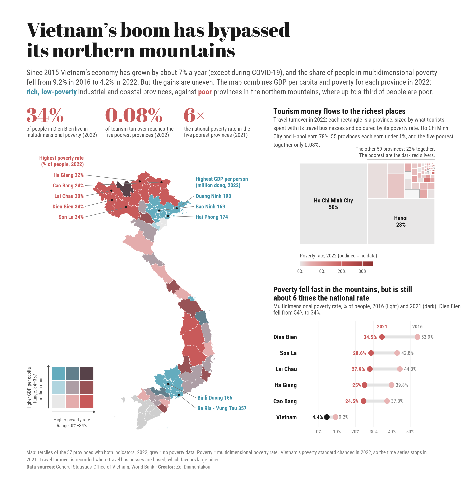

# Vietnam's boom has bypassed its northern mountains

**A data story on economic disparities and tourism across Vietnam's 63 provinces, built entirely in R.**

## The story

Since 2015 Vietnam's economy has grown by about 7% a year (except during COVID-19), and multidimensional poverty fell from 9.2% in 2016 to 4.2% in 2022. But the gains are uneven:

- **Wealth is concentrated** in industrial and coastal provinces such as Ba Ria–Vung Tau, Quang Ninh and Hai Phong, while **poverty is concentrated** in the northern mountains. In Dien Bien, 34% of people live in multidimensional poverty.
- **Tourism does not close the gap.** Ho Chi Minh City and Hanoi earn 78% of travel turnover; the five poorest provinces together earn 0.08%.
- **Progress is real but the gap remains.** Poverty in the mountain provinces fell fast between 2016 and 2021 (Dien Bien from 54% to 34%), but it is still about six times the national rate.

## How to read the infographic

| Part | Chart | What it shows |
|---|---|---|
| Map | Bivariate choropleth (3 × 3) | GDP per person and poverty rate for each province, 2022 |
| Big numbers | Key figures | The three findings in one line each |
| Tourism | Treemap | Each rectangle is a province, sized by travel turnover and coloured by poverty rate |
| Poverty over time | Dumbbell chart | Poverty rate in 2016 and 2021 for the five poorest provinces and Vietnam |

## Data

| Indicator | Year | Source |
|---|---|---|
| GDP per capita by province | 2022 | General Statistics Office of Vietnam |
| Multidimensional poverty rate by province | 2016–2022 | General Statistics Office of Vietnam |
| Travel turnover by province | 2022 | General Statistics Office of Vietnam |
| National GDP growth, visitors, GDP per capita | 2015–2022 | General Statistics Office of Vietnam, World Bank |
| Province boundaries | — | `diaphantinhenglish.geojson` |

The data are in [`data/Data.xlsx`](data/Data.xlsx); the sheet *Data description* lists each variable.

### Data notes

- **Break in series.** Vietnam introduced a new multidimensional poverty standard from 2022, so the 2016–2021 series is not comparable with 2022. The dumbbell chart stops in 2021; the map uses 2022.
- **Missing values.** Six Mekong Delta provinces have no poverty rate for 2022. They are grey on the map and outlined in the treemap.
- **Where tourism is counted.** Travel turnover is recorded where travel businesses are registered, which favours large cities: a tour to Ha Giang sold by a Hanoi agency counts for Hanoi. The real concentration is probably smaller than shown, but the gap is too large to change the conclusion.
- **Province names.** Some names in the Excel file contain hidden non-breaking spaces; the script cleans them before joining the data to the map.

## Repo layout

| Path | What's inside |
|---|---|
| `vietnam.R` | The full script: data, charts and layout |
| `vietnam.png` | The infographic |
| `data/` | Data workbook and province boundaries |

Made by [Zoi Diamantakou](https://github.com/ZoiDiama)
